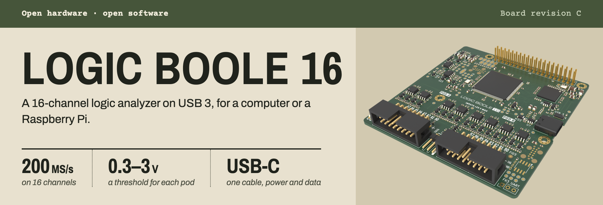
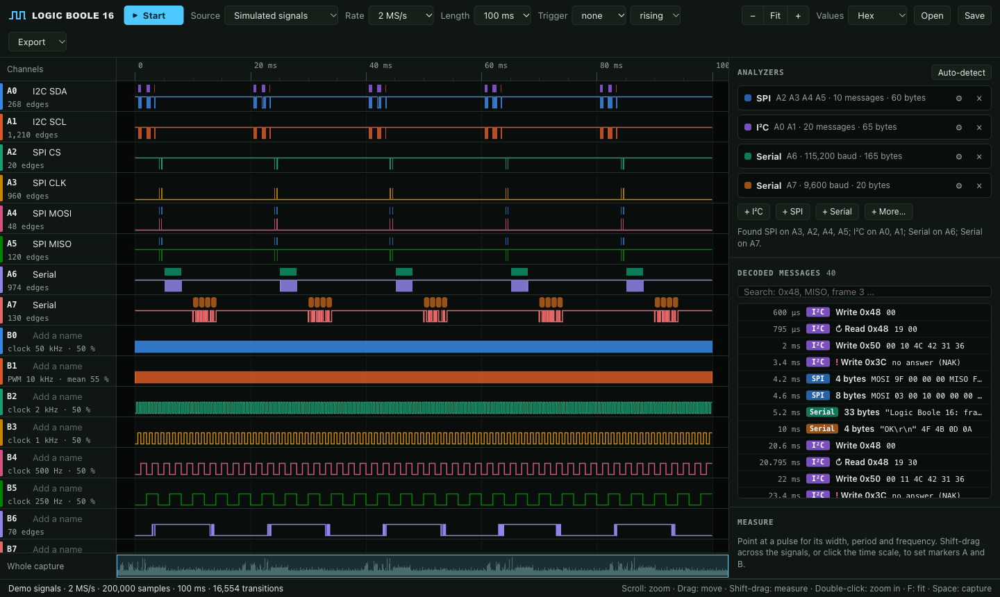

<div align="center">



# Logic Boole 16

**An open-source logic analyzer on USB 3: 16 channels at 200 MS/s, or 4 at 750 MS/s.**<br>
It runs from one USB-C cable on a computer, or sits on a Raspberry Pi 4 or 5 as a HAT+.

[](LICENSE)
[](software/LICENSE)
[](firmware/LICENSE)
[](hardware/)
[](#get-started)

**[Quick start](docs/quick-start.pdf)** · **[Datasheet](docs/datasheet.pdf)** · **[Software](software/README.md)** · **[FPGA design](gateware/README.md)** · **[Firmware](firmware/README.md)** · **[Protocol](docs/protocol.md)** · **[Schematic](hardware/logic-boole-16_revC_schematic.pdf)**

</div>

This repository holds everything for board revision C: the KiCad project and fabrication files, the FPGA design,
the firmware, and the software for the computer. The picture is a render of the design.

## What it does

| Feature | What you get |
|---|---|
| **16 channels at 200 MS/s** | Two pods of 8, a sample every 5 ns. Clocks up to 85 MHz are captured whole on every input |
| **8 channels at 375 MS/s, 4 at 750 MS/s** | A second FPGA design takes fewer channels more often: a sample every 1.33 ns with four, and clocks up to 200 MHz captured whole on every input. It samples and streams, with no trigger |
| **Two logic voltages in one capture** | A separate threshold for each pod, set from 0.3 V to 3 V |
| **A trigger in the FPGA** | Edges, levels, pulses by their length and levels that have lasted, up to four stages in turn, with a trigger input and a trigger output on a header |
| **Glitch filter and capture clock** | A filter for each channel up to 1.25 µs, and sampling on the circuit's own clock up to 50 MHz |
| **Streams to the host** | Samples go over USB 3 as they are taken, not into a small buffer on the board. The longest capture so far is 600 million samples |
| **Protected inputs** | 1 MΩ, with a comparator on every channel, designed for ±25 V |
| **One cable** | Power and data on USB-C, about 1 W |
| **Raspberry Pi HAT+** | Stacks on a Pi 4 or 5 with room for the Pi 5's Active Cooler. The Pi's own I²C, UART and SPI lines can take the place of pod channels, with no leads, once the board's solder jumpers are closed (simulated; not yet run on a board) |
| **Nothing to brick** | The board keeps no firmware: the software loads it over USB each time it is plugged in |
| **Decoders, scripts and AI agents** | I²C, SPI and serial in the app, [sigrok](https://sigrok.org)'s decoders from the command line, a Python package, and an MCP server |

## The app



`logicboole` opens the app in your browser: waveforms, a threshold for each pod, the trigger, and decoders
for I²C, SPI and serial that it can find by itself. The picture shows the app's built-in simulated signals, which
need no board: `logicboole --fake` runs the whole software that way.

## Get started

You need a Mac or a Linux computer (a Raspberry Pi 4 or 5 counts), Python 3.9 or later, and a USB 3 cable with
a USB-C plug for the board. A board comes with no cable, leads, spacers or screws.

**1. Install the software**

```sh
pipx install logicboole
brew install libusb    # macOS only. Linux has libusb already
```

To get pipx: `brew install pipx` on a Mac; `sudo apt install pipx` on Debian, Ubuntu and Raspberry Pi OS. Then
`pipx ensurepath` once, and a new terminal. (`pip install logicboole` in a virtual environment does the same.)
On Linux, the first `logicboole check` with the board plugged in prints the three commands that install the USB
rule, so that the board can be used without `sudo`: run them once.

From a copy of this repository nothing needs installing: `./logicboole`, in its top folder, does what
`logicboole` does here.

**2. Plug the board in and check it**

```sh
logicboole check
```

This checks the computer and the board in a few seconds and says what to do about anything that is missing.
The first time it loads a board, the software downloads the FX3's firmware image (about 110 kB), checks it and
keeps it: that once, the computer needs a connection to the internet.

**3. Capture**

```sh
# The app, in your browser
logicboole

# A capture to a file, with a threshold for each pod
logicboole capture bus.sr --rate 10M --time 2 -a 1.65 -b 0.9

# Wait for B0 to fall, and keep the millisecond after it
logicboole capture reset.sr --rate 200M --time 1ms --trigger "B0=f"

# What a protocol decoder finds in a saved capture
logicboole decode bus.lb16 i2c scl=A1 sda=A0

# Periods, frequencies and pulse lengths
logicboole measure bus.lb16
```

Captures are saved for PulseView (`.sr`), a waveform viewer (`.vcd`), a spreadsheet (`.csv`), or as the app's own
`.lb16`. The decoders are sigrok's, more than a hundred of them, run through `sigrok-cli` if it is installed.

> [!TIP]
> The [quick start guide](docs/quick-start.pdf) goes from the box to a first capture on two pages: where the
> cable and the probes go, and the steps in order. Connect ground first: join any pin of a pod's lower row to
> your circuit's ground.

**Scripts and AI agents.** `import logicboole` is a Python package that needs only libusb, and the commands
print JSON with `--json`. An AI agent can use the board by itself: through the command line with the skill file
in `software/skills/logic-boole-16/`, or through `logicboole mcp`, a Model Context Protocol server.
[software/README.md](software/README.md) has every command, the triggers, the Python package, and setting up
an agent.

## Specifications

The [datasheet](docs/datasheet.pdf) has the full tables, the pins, the dimensions and the limits.

| Item | Value |
|---|---|
| Channels | 16, in two keyed 2 × 8 pods. Every even pin is a ground |
| Sample rate | 200 MS/s on 16 channels, or 200 MS/s divided by a whole number. With the fast FPGA design: 375 MS/s on 8 channels (a pod), 750 MS/s on 4 |
| Fastest signal | Clocks up to 85 MHz and pulses down to 6 ns at 200 MS/s; clocks up to 200 MHz and pulses down to 2.5 ns at 750 MS/s |
| Logic levels | 1.2 to 5 V by design. Captured so far: 3.3 V and 5 V logic |
| Thresholds | 0.3 to 3.0 V in 0.75 mV steps, one for each pod |
| Inputs | 1 MΩ and 10 pF to ground, designed for ±25 V |
| Streaming, run-length format | 16 channels at 200 MS/s, for signals that change in up to 96 million samples a second |
| Streaming, raw format | 16 channels at 100 MS/s, any signal. At 200 MS/s, 892,928 samples. With the fast design, any signal: 4 channels at 750 MS/s, 8 at 375 or 16 at 187.5 |
| Before the trigger | The newest 8184 words: 16,368 samples in the raw format, far more on quiet signals |
| Trigger header | TRIG IN, and TRIG OUT 75 to 80 ns after the trigger sample |
| Host link | USB 3 at 5 Gbit/s. USB 2.0 works and carries a ninth as much |
| Power | 5 V from USB-C or the Pi's header, about 1 W |
| Size | 82 × 86 mm, four layers, parts on the top side only |
| Main parts | Spartan-6 XC6SLX9 FPGA, Infineon EZ-USB FX3, 16 fast comparators |

## Documentation

| Document | What is in it |
|---|---|
| [Quick start guide](docs/quick-start.pdf) | From the box to a first capture, on two pages |
| [Datasheet](docs/datasheet.pdf) | Specifications, pins, dimensions, typical uses, what has been measured and the known limits |
| [Software](software/README.md) | Every command, the triggers, file formats, the Python package, AI agents |
| [FPGA design](gateware/README.md) | What the design does, simulating it, building it, and the published bitstream |
| [Firmware](firmware/README.md) | Building the FX3's firmware, and where the firmware image comes from |
| [Protocol](docs/protocol.md) | The USB requests, the FPGA's registers and the format of the sample stream |
| [Schematic](hardware/logic-boole-16_revC_schematic.pdf) | Eight sheets, as a PDF |

## What is here

| Path | What it is |
|---|---|
| `logicboole` | Runs the host software from this folder |
| `software/` | The host software: the app, the command line, the Python package, and the skill file and MCP server for AI agents, with the FPGA bitstream they load |
| `gateware/` | The FPGA's design in Verilog, its simulation, and the script that builds it with ISE 14.7 |
| `firmware/` | The FX3's firmware in C, built against Infineon's FX3 SDK |
| `docs/` | The quick start guide and the datasheet, each as a PDF and as the page it is printed from, and the protocol |
| `hardware/kicad/` | The KiCad 10 project: schematic (8 sheets), board, design rules, and the symbols and two footprints that are not in KiCad's own libraries |
| `hardware/bom.csv` | Parts list: maker's part numbers, LCSC numbers, alternatives, and price and stock on the date given |
| `hardware/fabrication/` | Gerber and drill files (also zipped), and the parts list and placement file for JLCPCB |
| `hardware/3d/logic-boole-16.step` | 3D model of the assembled board |
| `hardware/images/` | Renders of the [front](hardware/images/front.jpg) and the [back](hardware/images/back.jpg) |

## Changing it

- **The app and the command line** are plain Python and JavaScript with no build step: edit and run.
  [software/README.md](software/README.md) says what is in each file.
- **The FPGA's design** is simulated with Icarus Verilog (`sh gateware/sim.sh`) and built with ISE 14.7.
- **The firmware** is one C file, built with `make` against Infineon's SDK.
- **The hardware**: open `hardware/kicad/logic-boole-16.kicad_pro` in KiCad 10. The project carries its own
  symbol and footprint libraries; everything else comes from the libraries KiCad installs.
- `./logicboole load --gateware FILE.bin --firmware FILE.img` runs your build on the board, and
  `./logicboole selftest` then checks the path from the FPGA to the computer, every word compared. Nothing you
  load can brick the board: unplug it and plug it in again, and it is as it was.

## Making boards

<details>
<summary><b>Having boards made</b>: the stack-up, what the assembler places, and what is soldered by hand</summary>

<br>

The fabrication files are the ones revision C was made from at JLCPCB.

**Bare board**

| Option | Value |
|---|---|
| Layers, thickness | 4 layers, 1.6 mm |
| Stack-up | JLC04161H-3313. The 90 Ω USB pairs and the 50 Ω lines are sized for it; another stack-up changes their impedance |
| Copper | 1 oz outer, 0.5 oz inner |
| Surface finish | ENIG, for the 0.8 mm BGA and the 0.5 mm pitch parts |
| Smallest features | 0.1 mm track and gap; vias with a 0.2 mm hole in a 0.45 mm pad |

**Assembly**

- Standard assembly, top side only. JLCPCB places 410 parts of 70 types.
- The FX3 (U12) is a BGA and needs X-ray inspection.
- JLCPCB leaves two matched lines unticked, and the boards come without them unless they are ticked: J1, the
  USB-C receptacle, and U3 and U4, the TPS62A02P regulators.
- Check stock of the input ESD diodes (ESD701DPYR, 16 a board) before ordering more than a few boards.

**By hand afterwards**

- J8, the 40-pin stacking header, is not in JLCPCB's library. It is a SparkFun PRT-16764, soldered square to
  the board after delivery.
- On a Raspberry Pi the board sits on four M2.5 × 16 mm spacers, held by eight M2.5 × 6 mm screws, which leaves
  room for the Pi 5's Active Cooler. Spacers and screws are not part of the board.

</details>

<details>
<summary><b>Parts notes</b>: the comparators, the positions left empty, and the programming connectors</summary>

<br>

- **Comparators.** U15 to U18, on pod A, are MX3502S; U19 to U22, on pod B, are TLV3502AIDR. The two parts are
  pin-compatible and either fits all eight positions. JLCPCB draws them a quarter turn apart, so check their
  rotation in the placement preview after changing one.
- **Positions left empty.** U13 takes an SPI flash and J3 a header for the FX3's serial port. They and a few
  resistors are marked "not fitted" in the parts list.
- **Programming connectors.** J2 (FX3) and J4 (FPGA) are Tag-Connect TC2050 footprints for the TC2050-IDC cable.
  They take no part.

</details>

## License

Copyright © 2026 Michael Walker.

| Part | License | Text |
|---|---|---|
| `hardware/`, `gateware/`, `docs/`, and whatever is not named below | CERN-OHL-S v2 | [LICENSE](LICENSE) |
| `software/` and the `logicboole` launcher | GPL-3.0-or-later | [software/LICENSE](software/LICENSE) |
| `firmware/` | MIT | [firmware/LICENSE](firmware/LICENSE) |

**The hardware design and the FPGA design.** This source describes Open Hardware and is licensed under the
CERN-OHL-S v2. You may redistribute and modify this source and make products using it under the terms of the
CERN-OHL-S v2, in [LICENSE](LICENSE) and at https://ohwr.org/cern_ohl_s_v2.txt.

This source is distributed WITHOUT ANY EXPRESS OR IMPLIED WARRANTY, INCLUDING OF MERCHANTABILITY, SATISFACTORY
QUALITY AND FITNESS FOR A PARTICULAR PURPOSE. Please see the CERN-OHL-S v2 for applicable conditions.

**The host software** is free software: you can redistribute it and/or modify it under the terms of the GNU
General Public License as published by the Free Software Foundation, either version 3 of the License, or (at your
option) any later version. It is distributed in the hope that it will be useful, but WITHOUT ANY WARRANTY; without
even the implied warranty of MERCHANTABILITY or FITNESS FOR A PARTICULAR PURPOSE. See the GNU General Public
License for more details.

**The firmware's source** is under the MIT license.

**Two built files** are loaded into the board, and each comes under the terms of what it is built from, not
under the host software's:

- `software/logicboole/data/gateware.bin` is the FPGA design, built from `gateware/`: CERN-OHL-S v2.
- **The firmware image is not in this repository.** It is built from `firmware/firmware.c` with Infineon's EZ-USB
  FX3 SDK and also holds code of the SDK's libraries, which is Infineon's and stays under the license of
  Infineon's SDK. It is a file of the [firmware-2 release](https://github.com/mgwalkerjr95/logic-boole-16/releases/tag/firmware-2), for use on a Logic Boole 16; the host software
  downloads it from there once. [firmware/README.md](firmware/README.md) says how to build it yourself.

The fonts in `docs/datasheet/fonts/` are other people's work, each under the SIL Open Font License:
[docs/datasheet/fonts/README.md](docs/datasheet/fonts/README.md).

The name Logic Boole and its logo are not part of the licenses.
