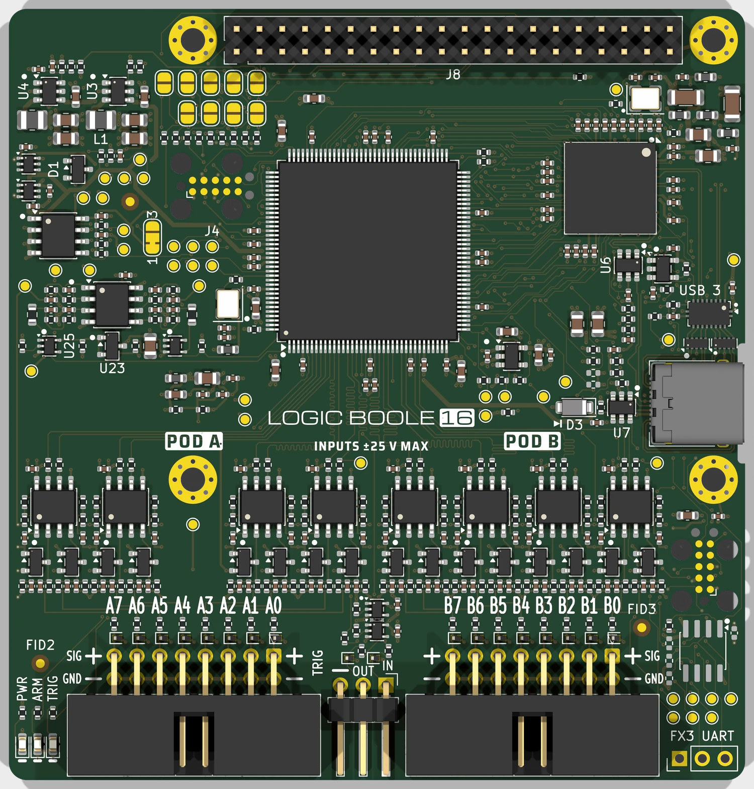

# Logic Boole 16

A 16-channel logic analyzer on USB 3 that also mounts on a Raspberry Pi 4 or 5 as a HAT+.

- 16 inputs in two pods of 8, sampled at up to 200 MS/s: a sample every 5 ns
- A separate threshold for each pod, set from 0.3 V to 3 V, so one capture can hold two logic voltages
- A trigger in the FPGA: edges, levels, pulses by their length, up to four stages in turn, with a trigger input
  and a trigger output on a header
- A glitch filter for each channel, and capture on the circuit's own clock up to 50 MHz
- 1 MΩ inputs, with a comparator on every channel
- USB 3 at 5 Gbit/s through an Infineon FX3, with a Spartan-6 FPGA doing the sampling
- Power and data on one USB-C cable
- 82 × 86 mm, four layers, parts on the top side only

This repository holds everything for board revision C: the hardware design, the FPGA's design, the firmware,
and the software for the computer.

## Using a board

**New to the board?** The [quick start guide](docs/quick-start.pdf) goes from the box to a first capture on two
pages: what you need, where the cable and the probes go, and the steps in order.

The software needs Python 3.9 or later and libusb (`brew install libusb` on macOS; Linux has it, and needs the
USB rule in [software/README.md](software/README.md) installed once). From this folder:

    ./logicboole check

checks the computer and the board in a few seconds and says what to do about anything that is missing. Then

    ./logicboole

This loads the board and opens the app in your browser: waveforms, thresholds for each pod, the trigger, and
decoders for I²C, SPI and serial. Nothing needs installing, and `./logicboole --fake` runs it with no board.

The first time it loads a board, the software downloads the FX3's firmware image (about 110 kB), checks it and
keeps it: that once, the computer needs a connection to the internet.

    ./logicboole capture bus.sr --rate 10M --time 2 -a 1.65 -b 0.9

takes a capture from the command line into a file for PulseView (`.sr`), a waveform viewer (`.vcd`) or a
spreadsheet (`.csv`).

    ./logicboole capture reset.sr --rate 200M --time 1ms --trigger "B0=f"

waits for B0 to fall and keeps the millisecond after it, with some of what came before.

    ./logicboole decode bus.lb16 i2c scl=A1 sda=A0

lists what a protocol decoder finds in a saved capture. The decoders are [sigrok](https://sigrok.org)'s, more
than a hundred of them, run through `sigrok-cli` if it is installed. `./logicboole measure bus.lb16` reads
periods, frequencies and pulse lengths off one.

An AI agent can use the board by itself: through the command line with the skill file in
`software/skills/logic-boole-16/`, or through `./logicboole mcp`, a Model Context Protocol server.

[software/README.md](software/README.md) has the rest: every command, the triggers, JSON output for scripts,
the Python package, and setting up an agent.

The board keeps no firmware: the software loads the FX3 and the FPGA over USB each time the board is plugged in.
Nothing you load can brick it. Unplug it and plug it in again, and it is as it was.

## What is here

| Path | What it is |
|---|---|
| `logicboole` | Runs the host software from this folder |
| `software/` | The host software: the app, the command line, the Python package, and the skill file and MCP server for AI agents, with the FPGA bitstream they load. [README](software/README.md) |
| `gateware/` | The FPGA's design in Verilog, its simulation, and the script that builds it with ISE 14.7. [README](gateware/README.md) |
| `firmware/` | The FX3's firmware in C, built against Infineon's FX3 SDK. [README](firmware/README.md) |
| `docs/quick-start.pdf` | The quick start guide, and `quick-start.html`, the page it is printed from |
| `docs/protocol.md` | The USB requests, the FPGA's registers and the format of the sample stream |
| `hardware/kicad/` | The KiCad 10 project: schematic (8 sheets), board, design rules, and the symbols and two footprints that are not in KiCad's own libraries |
| `hardware/logic-boole-16_revC_schematic.pdf` | The schematic as a PDF |
| `hardware/bom.csv` | Parts list: maker's part numbers, LCSC numbers, alternatives, and price and stock on the date given |
| `hardware/fabrication/gerbers/` | Gerber and drill files, also zipped as `logic-boole-16_revC_gerbers.zip` |
| `hardware/fabrication/logic-boole-16_revC_bom_jlcpcb.csv` | The parts JLCPCB places, by LCSC number |
| `hardware/fabrication/logic-boole-16_revC_cpl_jlcpcb.csv` | Where each of those parts goes and how it is turned, for JLCPCB's footprints |
| `hardware/3d/logic-boole-16.step` | 3D model of the assembled board |
| `hardware/images/` | Renders of the front and the back |

## Changing it

- **The app and the command line** are plain Python and JavaScript with no build step: edit and run.
  [software/README.md](software/README.md) says what is in each file.
- **The FPGA's design** is simulated with Icarus Verilog (`sh gateware/sim.sh`) and built with ISE 14.7.
- **The firmware** is one C file, built with `make` against Infineon's SDK.
- `./logicboole load --gateware FILE.bin --firmware FILE.img` runs your build on the board, and
  `./logicboole selftest` then checks the path from the FPGA to the computer, every word compared.

## Opening the hardware design

Open `hardware/kicad/logic-boole-16.kicad_pro` in KiCad 10. The project carries its own symbol and footprint
libraries; everything else comes from the libraries KiCad installs.

## Having boards made

The fabrication files are the ones revision C was made from at JLCPCB.

**Bare board**

| Option | Value |
|---|---|
| Layers, thickness | 4 layers, 1.6 mm |
| Stack-up | JLC04161H-3313. The 90 Ω USB pairs and the 50 Ω lines are sized for it; another stack-up changes their impedance |
| Copper | 1 oz outer, 0.5 oz inner |
| Surface finish | ENIG, for the 0.8 mm BGA and the 0.5 mm pitch parts |
| Smallest features | 0.1 mm track and gap; vias with a 0.2 mm hole in a 0.45 mm pad |

**Assembly**

- Standard assembly, top side only. JLCPCB places 410 parts of 70 types.
- The FX3 (U12) is a BGA and needs X-ray inspection.
- JLCPCB leaves two matched lines unticked, and the boards come without them unless they are ticked: J1, the
  USB-C receptacle, and U3 and U4, the TPS62A02P regulators.
- Check stock of the input ESD diodes (ESD701DPYR, 16 a board) before ordering more than a few boards.

**By hand afterwards**

- J8, the 40-pin stacking header, is not in JLCPCB's library. It is a SparkFun PRT-16764, soldered square to
  the board after delivery.
- On a Raspberry Pi the board sits on four M2.5 × 16 mm spacers, which leaves room for the Pi 5's Active Cooler.

## Parts notes

- **Comparators.** U15 to U18, on pod A, are MX3502S; U19 to U22, on pod B, are TLV3502AIDR. The two parts are
  pin-compatible and either fits all eight positions. JLCPCB draws them a quarter turn apart, so check their
  rotation in the placement preview after changing one.
- **Positions left empty.** U13 takes an SPI flash and J3 a header for the FX3's serial port. They and a few
  resistors are marked "not fitted" in the parts list.
- **Programming connectors.** J2 (FX3) and J4 (FPGA) are Tag-Connect TC2050 footprints for the TC2050-IDC cable.
  They take no part.

## License

Copyright © 2026 Michael Walker.

| Part | License | Text |
|---|---|---|
| `hardware/`, `gateware/`, `docs/`, and whatever is not named below | CERN-OHL-S v2 | [LICENSE](LICENSE) |
| `software/` and the `logicboole` launcher | GPL-3.0-or-later | [software/LICENSE](software/LICENSE) |
| `firmware/` | MIT | [firmware/LICENSE](firmware/LICENSE) |

**The hardware design and the FPGA design.** This source describes Open Hardware and is licensed under the
CERN-OHL-S v2. You may redistribute and modify this source and make products using it under the terms of the
CERN-OHL-S v2, in [LICENSE](LICENSE) and at https://ohwr.org/cern_ohl_s_v2.txt.

This source is distributed WITHOUT ANY EXPRESS OR IMPLIED WARRANTY, INCLUDING OF MERCHANTABILITY, SATISFACTORY
QUALITY AND FITNESS FOR A PARTICULAR PURPOSE. Please see the CERN-OHL-S v2 for applicable conditions.

**The host software** is free software: you can redistribute it and/or modify it under the terms of the GNU
General Public License as published by the Free Software Foundation, either version 3 of the License, or (at your
option) any later version. It is distributed in the hope that it will be useful, but WITHOUT ANY WARRANTY; without
even the implied warranty of MERCHANTABILITY or FITNESS FOR A PARTICULAR PURPOSE. See the GNU General Public
License for more details.

**The firmware's source** is under the MIT license.

**Two built files** are loaded into the board, and each comes under the terms of what it is built from, not
under the host software's:

- `software/logicboole/data/gateware.bin` is the FPGA design, built from `gateware/`: CERN-OHL-S v2.
- **The firmware image is not in this repository.** It is built from `firmware/firmware.c` with Infineon's EZ-USB
  FX3 SDK and also holds code of the SDK's libraries, which is Infineon's and stays under the license of
  Infineon's SDK. It is a file of the [firmware-2 release](https://github.com/mgwalkerjr95/logic-boole-16/releases/tag/firmware-2), for use on a Logic Boole 16; the host software
  downloads it from there once. [firmware/README.md](firmware/README.md) says how to build it yourself.

The name Logic Boole and its logo are not part of the licenses.
